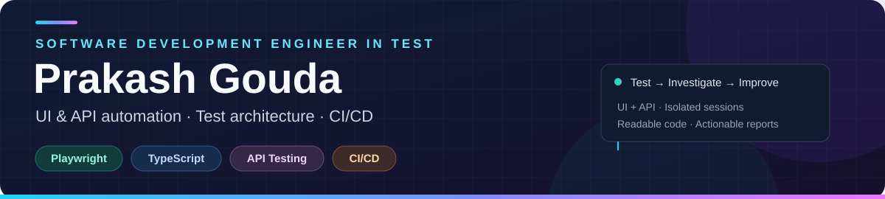

  

## Hi, I’m Prakash

I work with Playwright, TypeScript, JavaScript and Python across browser automation, API testing and evaluation of systems that use large language models (LLMs). I focus on maintainable frameworks, isolated test data and reports that make failures easier to investigate.

I have built Azure DevOps pipelines to run tests and publish Allure results, Playwright HTML, Newman HTML Extra, pipeline summaries and interactive Allure reports. My delivery work also includes Git/GitHub repositories. The projects here show how I approach Page Object Model, reusable fixtures, permission boundaries, database consistency and evaluation design.

Start with the [browser failure investigation](https://github.com/PrakashgoudaAI/playwright-starter/blob/main/docs/walkthrough.md) or [reservation correctness walkthrough](https://github.com/PrakashgoudaAI/api-contract-security-lab/blob/main/docs/walkthrough.md).

[Skills](#skills--tools) · [Engineering practice](#engineering-practice) · [Projects](#projects) · [Connect](#connect)

## Skills & tools

**Languages**

  
  
  

**Automation & APIs**

  
  
  
  
  
  

**CI/CD & reporting**

  
  
  
  
  

**Architecture & AI quality**

  
  
  
  
  

Newman is included for collection compatibility; Postman CLI is the current runner. The system-design examples focus on testability, isolation, transaction boundaries, replay and complete CI evidence.

## Engineering practice

| Area | What I work on | Examples |
| :--- | :--- | :--- |
| Playwright automation | Page Object Model (POM), typed fixtures, reusable controls, session isolation, cross-browser and selected accessibility checks | [Browser framework](https://github.com/PrakashgoudaAI/playwright-starter) |
| API testing | REST API checks, role and tenant boundaries, request/response contracts, SQL persistence, idempotency and consumer compatibility | [Reservation API](https://github.com/PrakashgoudaAI/api-contract-security-lab) · [Postman collection](https://github.com/PrakashgoudaAI/postman-api-tests) |
| CI/CD and diagnostics | Azure DevOps pipeline implementation, Git/GitHub repository work, GitHub Actions checks, sharded runs and Allure/JUnit/HTML reporting | [Public CI and reports](https://github.com/PrakashgoudaAI/playwright-starter/blob/main/docs/SHARDED-CI.md) · [Azure reference pipeline](https://github.com/PrakashgoudaAI/playwright-starter/blob/main/docs/azure-pipelines.md) |
| Test architecture and system design | Responsibility boundaries, state ownership, database transactions, migration integrity, replay and failure recovery | [Quality strategy](https://github.com/PrakashgoudaAI/api-contract-security-lab/blob/main/docs/quality-strategy.md) · [Design decisions](https://github.com/PrakashgoudaAI/api-contract-security-lab/tree/main/docs/decisions) |
| AI testing and evaluation | LLM evaluation, retrieval relevance, evidence support, refusals, structured outputs, repeated trials and tool cancellation | [RAG/MCP lab](https://github.com/PrakashgoudaAI/rag-agent-quality-lab) · [Release evaluation](https://github.com/PrakashgoudaAI/release-evidence-eval) |

## Projects

| Project | Problem explored | Evidence to review |
| :--- | :--- | :--- |
| [Playwright Starter](https://github.com/PrakashgoudaAI/playwright-starter) | Reliable UI and API coverage with useful failure reports | Chromium, Firefox and WebKit; session isolation; selected accessibility checks; two CI shards checked against an expected test-ID plan. [Workflow](https://github.com/PrakashgoudaAI/playwright-starter/actions/workflows/verify.yml) |
| [API Contract & Security Lab](https://github.com/PrakashgoudaAI/api-contract-security-lab) | Correct reservations under retries, permissions and competing writers | PostgreSQL tests through two service processes, signed-token rejection cases, migration integrity and a real dashboard consumer contract. [Workflow](https://github.com/PrakashgoudaAI/api-contract-security-lab/actions/workflows/verify.yml) |
| [RAG & Agent Quality Lab](https://github.com/PrakashgoudaAI/rag-agent-quality-lab) | Grounded answers, refusal behavior and uncertain tool outcomes | Fixed evaluation cases, archived local-model experiments, bounded MCP calls and cancellation tests. [Measured results](https://github.com/PrakashgoudaAI/rag-agent-quality-lab/tree/main/docs/experiments) |
| [Release Evidence Eval](https://github.com/PrakashgoudaAI/release-evidence-eval) | Whether a release recommendation follows the supplied CI evidence | 112 automated tests, repeated model trials, a separate reserved-case study and policy-guard fault checks. [Walkthrough](https://github.com/PrakashgoudaAI/release-evidence-eval/blob/main/docs/walkthrough.md) |
| [Postman API Tests](https://github.com/PrakashgoudaAI/postman-api-tests) | Role permissions and persisted state below the UI | Two data-driven roles, 26 requests and 48 assertions, with local CLI execution and JSON/JUnit reports. [Workflow](https://github.com/PrakashgoudaAI/postman-api-tests/actions/workflows/verify.yml) |

The evaluation projects retain failed model runs and separate implementation checks from answer quality. Their datasets are synthetic and author-written; they are not independent benchmarks or autonomous release approvers.

## How I approach the work

Check state after a mutation and permissions below the UI. Keep tests independent, investigate instability before adding retries, and check that the full planned suite ran before trusting its summary. Make trade-offs and failed experiments easy for another engineer to inspect.

## Learning focus

  

AI-augmented testing is my next learning focus. The AI testing projects above evaluate model and tool behavior; they are separate from using AI to assist test development.

## Connect

  
  
  
  

Employer, customer and confidential material stay out of these repositories.
